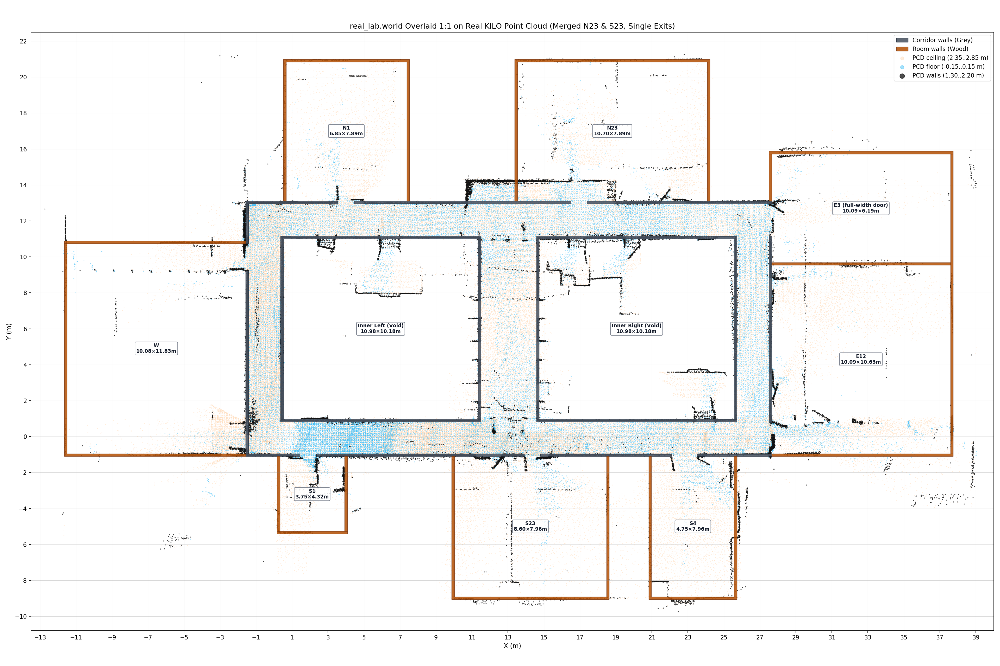
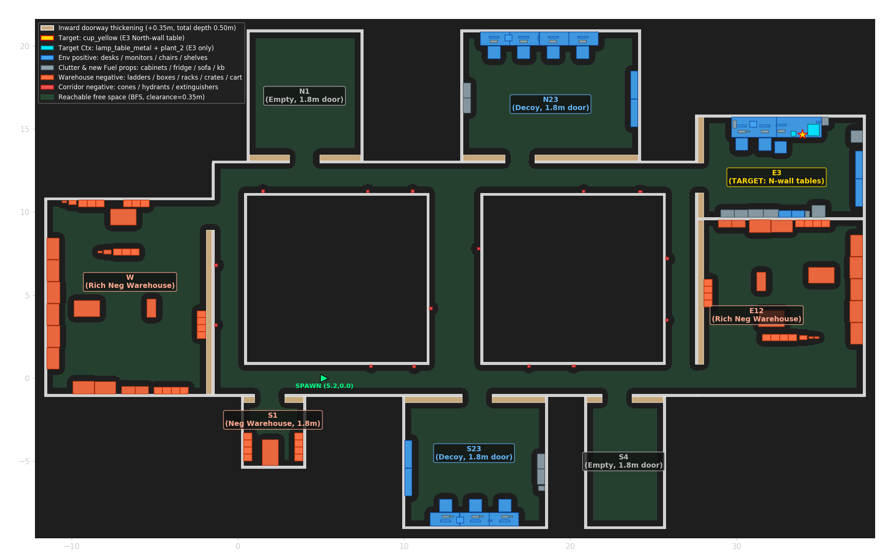
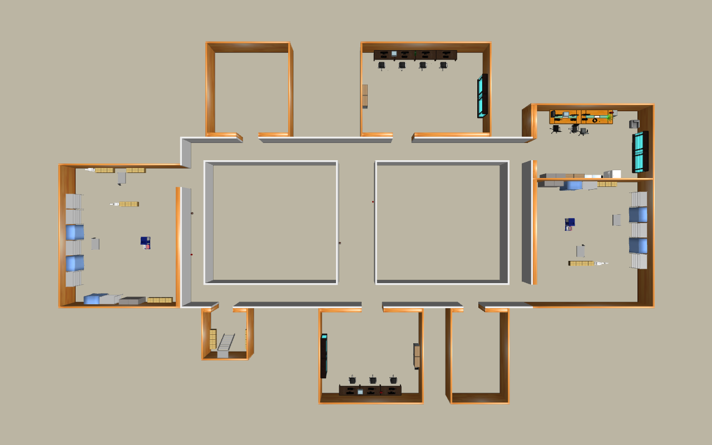
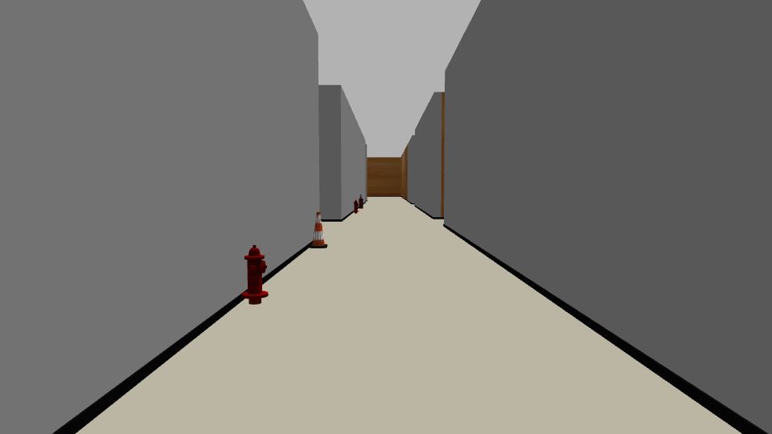
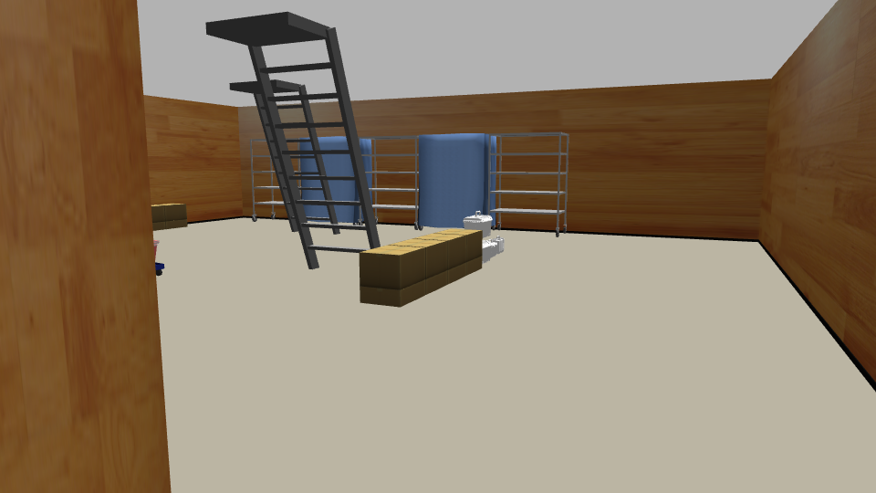
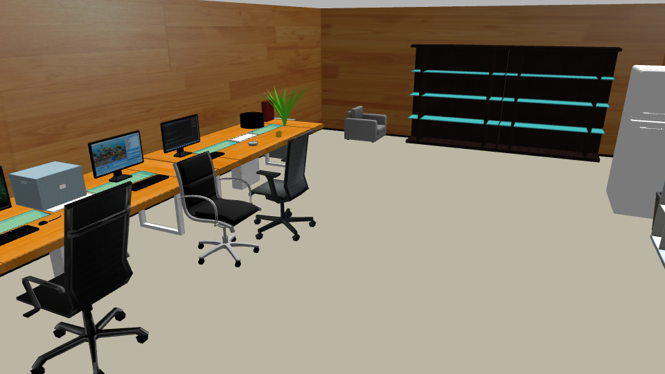
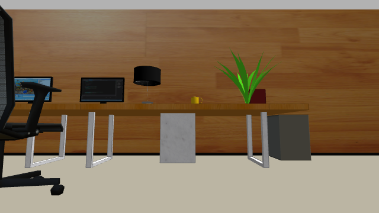
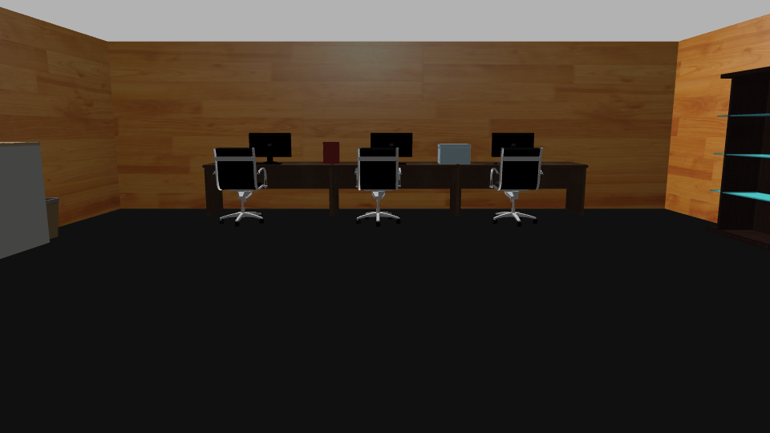

# LSTE Sim2Real：面向真实实验室场景的无图视觉目标搜索与自主导航

本项目专攻真实实验室场景 **`worlds/sim2real/real_lab.world`** 的 **Sim2Real** 实现：在无先验地图的前提下，驱动 Pro3 机器人在 1:1 复刻真实楼层结构的 Gazebo 环境中完成在线 SLAM 建图、走廊-门洞拓扑探索、开放词汇视觉目标识别与自主接近导航。

---

## 1. 真实场景 1:1 建模与可视化

`worlds/sim2real/real_lab.world` 基于实验室真实激光点云（`学校走廊_KILO.pcd`，1:1 比例对齐地面 `z = 0`）构建，保留了完整的“日”字型走廊与外围 8 间向外单出口房间（灰色走廊墙体 + 木纹房间墙体 + 深黑地面，共 41 个静态墙体 link，墙厚统一 `0.15 m`）。

### 1.1 点云叠加、家具平面规划与 Gazebo 多视角渲染

| 1:1 墙体与真实点云叠加校验图 | 家具/目标/可行域平面规划图（出生点朝东 `yaw=0`） |
| :---: | :---: |
|  |  |

| Gazebo 全局俯视图 | 南走廊出生点朝东视角 | 东仓库 `E12` 门口视角 |
| :---: | :---: | :---: |
|  |  |  |

| 目标房 `E3` 全景视角 | 目标工位近景（黄杯 + 台灯 + 绿植） | 诱导办公房 `S23` 门口视角 |
| :---: | :---: | :---: |
|  |  |  |

### 1.2 场景关键几何规格

- **全图包围盒**：`x ∈ [-11.66, 37.75]`（**49.41 m**），`y ∈ [-9.05, 21.00]`（**30.05 m**）
- **走廊净宽**：南走廊 `1.77 m`（默认出生点所在）、西/东走廊 `1.79 m`、北走廊 `1.80 m`、中轴连通走廊 `3.09 m`
- **房间与门洞**（已全部统一为 **`1.80 m`** 门宽、`0.50 m` 门道深，并配置了办公/仓库/走廊真实家具与目标）：
  - **北侧**：`N1`（空房对照）、`N23`（诱导办公房）
  - **南侧**：`S1`（负分小仓库）、`S23`（诱导办公房）、`S4`（空房对照）
  - **西侧**：`W`（负分大仓库）
  - **东侧**：`E12`（负分仓库）、`E3`（**目标办公房**，含 `cup_yellow` + `lamp_table_metal` + `plant_2`）

---

## 2. 针对 `real_lab` 的 Sim2Real 适配

为匹配真实楼层“**`1.80 m` 统一门洞（`0.50 m` 门道深）+ 环廊（`1.77–1.80 m`）+ 走廊/仓库低矮障碍（`0.23–0.38 m`）+ 大范围全图（`49.4 × 30.1 m`）**”的物理约束，对全链路感知、建图、导航与拓扑参数做了对齐：

- **全图 SLAM 边界与双分辨率代价地图**（`online_slam_frontier.launch`、`teb_navigation.launch`）：`gmapping` 范围扩展至 `x ∈ [-14, 40]`、`y ∈ [-11, 23]`，全局建图保持 `0.10 m` 以确保大地图下 BFS 实时性，局部滚动代价地图细化为 **`0.05 m`**。
- **低矮障碍感知与 3D 体素避障**（`lste_pro3_to_scan.launch`、`teb_navigation.launch`、`body_cloud_costmap.yaml`）：将 2D 切片下限下调至 `-0.63` 并默认启用 `body_cloud_obstacles`（`0.03–0.70 m`），避免漏检走廊矮消防栓/锥桶与仓库矮箱。
- **物理净空链与语义门控**（`pipeline_defaults.yaml`、`global_frontier_semantic_belief.py`）：`robot_radius = 0.25 m`、`TEB min_obstacle_dist = 0.10 m`、`clearance = 0.45 m`、`completed_radius = 0.95 m`、`room_view_min_depth = -0.15 m`、`MUX_GOVERNOR_MIN_GAP = 0.30 m`；并针对 `real_lab.json`（7 正向词 + 6 负向线索）将语义门控下调至 `0.06 / 0.20`。

---

## 3. 系统架构与数据流

| 模块 | 主要职责 |
| --- | --- |
| 仿真与传感器 | Gazebo 加载 `worlds/sim2real/real_lab.world` 并单独生成 Pro3；相机供视觉检测，2D/3D 激光与里程计供建图和导航。 |
| 任务与提示词 | 任务 JSON 描述目标、环境先验、关联物与负面线索；Prompt 节点优先复用任务缓存，未命中时启动 MiniCPM。 |
| 感知与状态 | WeDetect（PyTorch）结合目标、环境与上下文检测进行打分和多帧状态锁定，抑制单帧误检。 |
| 建图与探索 | 在线 SLAM 发布 `/map`；`lste_global_frontier` 基于连通自由空间与 Place/Portal 拓扑选择可达前沿。 |
| 目标管理与控制 | Goal Manager 仲裁探索与目标跟随；Navfn 验证全局可达性，TEB（`persistent_stream`）与速度 mux 统一下发 `/cmd_vel`。 |
| 日志与取证 | Navigation Metrics 旁路记录里程计轨迹、任务事件与失败快照。 |

```text
任务 JSON → 提示词缓存 / MiniCPM → WeDetect → 评分与状态
                                             ↓
激光 + 里程计 → 在线 SLAM → 全局前沿探索 → Goal Manager
                                             ↓
                                  Navfn → TEB → 速度 mux → Pro3
                                             ↓
                                多帧目标完成证据 → /lste/task_done
```

---

## 4. 配置与启动

### 4.1 核心配置

统一在 [scripts/config/pipeline_defaults.yaml](scripts/config/pipeline_defaults.yaml) 中管理（修改后重启节点即可生效，无需重新编译）：

```yaml
WORLD: worlds/sim2real/real_lab.world
TASK_JSON: model/Data_exchange/vlm_prompt/lab/real_lab.json
TASK_ID: real_lab

PRO3_SPAWN_X: 5.2
PRO3_SPAWN_Y: 0
PRO3_SPAWN_Z: 0.1
PRO3_SPAWN_YAW: 0

LSTE_CONTROLLER: teb
ONLINE_SLAM_ENABLED: true
GLOBAL_FRONTIER_ENABLED: true
```

> 切换出生点或任务目标时，请确认 `(PRO3_SPAWN_X, PRO3_SPAWN_Y)` 位于无碰撞的可通行走廊/房间内，并同步更新 `TASK_JSON`、`TASK_ID` 及评估配置。

### 4.2 启动、监控与停止

在仓库根目录执行：

```bash
cd /home/zrz/work/sim2real/LSTE
export LSTE_WS="$PWD"
source scripts/config/pipeline_env.sh

# 停止上一轮残留会话
./scripts/lifecycle/stop_all_tmux.sh

# 启动 Gazebo (real_lab.world)、Pro3、感知、SLAM、探索与 TEB 导航
./scripts/lifecycle/run_all_tmux.sh
```

常用监控命令（另一终端执行）：

```bash
cd /home/zrz/work/sim2real/LSTE
source scripts/config/pipeline_env.sh

tmux list-windows -t lste
tmux attach -t lste
rostopic echo /lste/task_done
rviz -d src/lste_topo_access/launch/gp_frontier.rviz
```

运行日志与失败快照默认保存在 `runtime/navigation/logs/<YYYYMMDD_HHMMSS>/`。实验结束后请运行 `./scripts/lifecycle/stop_all_tmux.sh` 正常落盘并退出。
