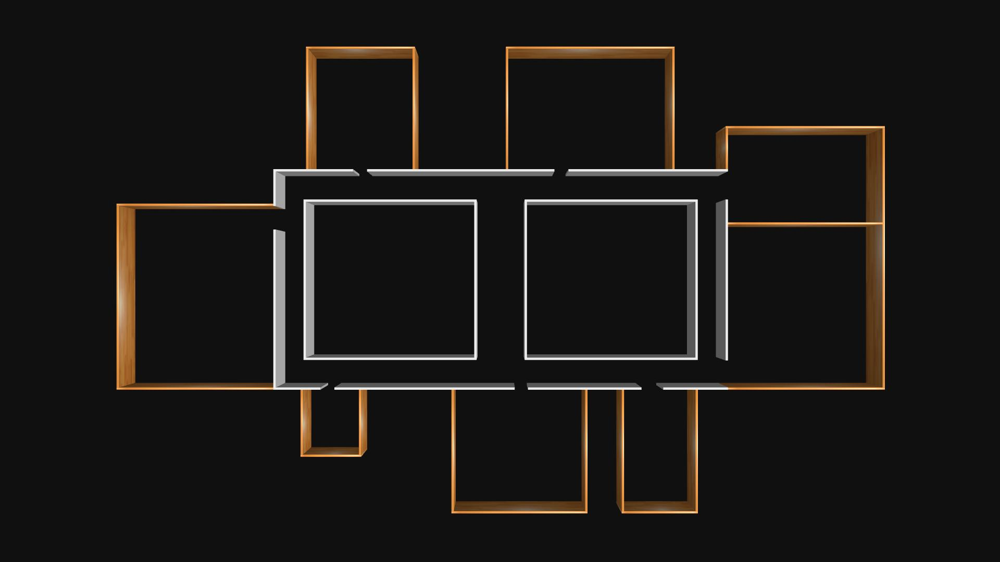
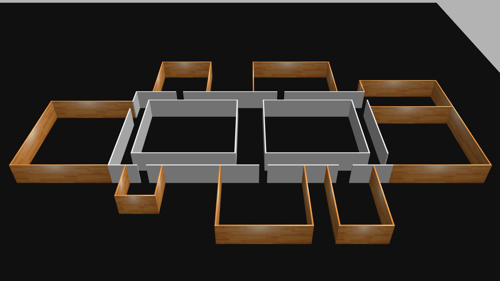
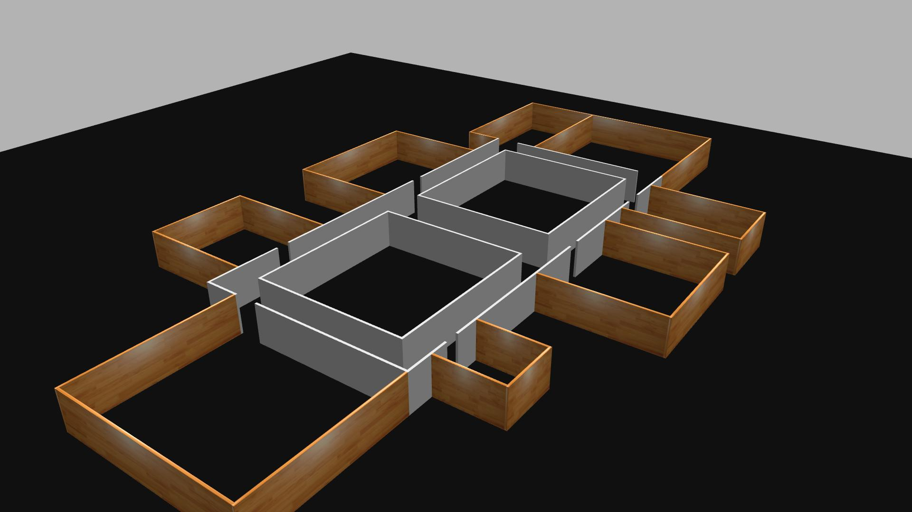
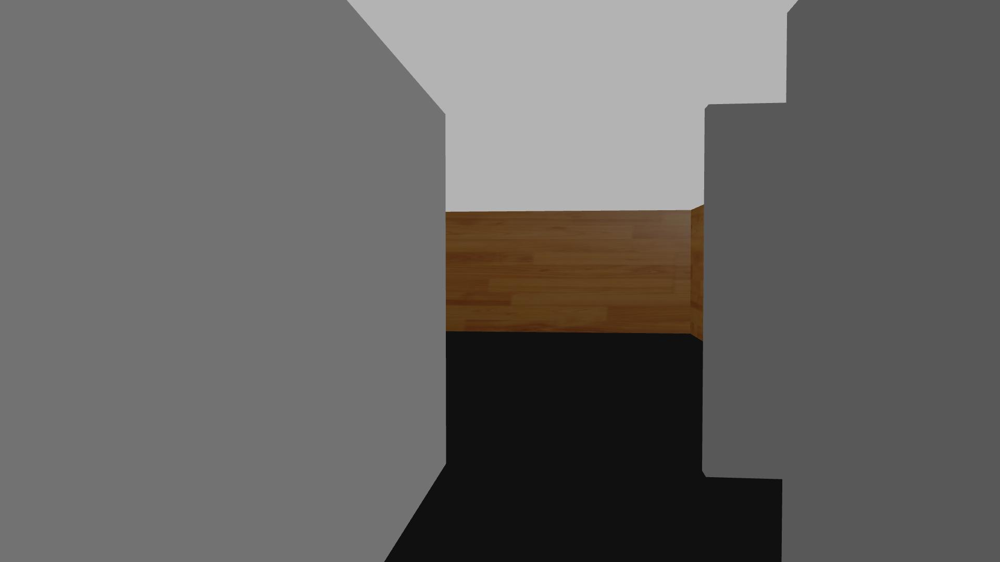

# LSTE Sim2Real：面向真实实验室场景的无图视觉目标搜索与自主导航

本项目专攻真实实验室场景 **`worlds/sim2real/real_lab.world`** 的 **Sim2Real** 实现：在无先验地图的前提下，驱动 Pro3 机器人在 1:1 复刻真实楼层结构的 Gazebo 环境中完成在线 SLAM 建图、走廊-门洞拓扑探索、开放词汇视觉目标识别与自主接近导航。

---

## 1. 真实场景 1:1 建模与可视化

`worlds/sim2real/real_lab.world` 基于实验室真实激光点云（`学校走廊_KILO.pcd`，1:1 比例对齐地面 `z = 0`）构建，保留了完整的“日”字型走廊与外围 8 间向外单出口房间（灰色走廊墙体 + 木纹房间墙体 + 深黑地面，共 41 个静态墙体 link，墙厚统一 `0.15 m`）。

### 1.1 点云叠加与 Gazebo 多视角渲染


| 正俯视全局图 | 三维斜俯视全局图 |
| :---: | :---: |
|  |  |

| 西南对角透视图 | 中央连通走廊视角 | 走廊望向 E3 房间视角 |
| :---: | :---: | :---: |
|  |  |  |

### 1.2 场景关键几何规格

- **全图包围盒**：`x ∈ [-11.66, 37.75]`（**49.41 m**），`y ∈ [-9.05, 21.00]`（**30.05 m**）
- **走廊净宽**：南走廊 `1.77 m`（默认出生点所在）、西/东走廊 `1.79 m`、北走廊 `1.80 m`、中轴连通走廊 `3.09 m`
- **房间与门洞**：
  - **北侧**：`N1`（`6.70 × 7.74 m`，门宽 `0.90 m`）、`N23`（`10.55 × 7.74 m`，门宽 `0.90 m`）
  - **南侧**：`S1`（`3.60 × 4.17 m`，门宽 `0.90 m`）、`S23`（`8.45 × 7.81 m`，门宽 **`0.85 m`**）、`S4`（`4.60 × 7.81 m`，门宽 `1.40 m`）
  - **西侧**：`W`（`9.93 × 11.68 m`，门宽 `1.515 m`）
  - **东侧**：`E12`（`9.94 × 10.48 m`，开口 `1.735 m`）、`E3`（`9.94 × 6.04 m`，开口 `1.80 m`）

---

## 2. 针对 `real_lab` 的 Sim2Real 适配

为匹配真实楼层“**窄单开门（`0.85–0.90 m`）+ 薄墙（`0.15 m`）+ 窄环廊（`1.77–1.80 m`）+ 大范围全图（`49.4 × 30.1 m`）**”的物理约束，对全链路导航与拓扑参数做了对齐：

- **全图 SLAM 边界与 5 cm 分辨率**（`src/lste_topo_access/launch/online_slam_frontier.launch`）：`gmapping` 范围扩展至 `x ∈ [-14, 40]`、`y ∈ [-11, 23]`，栅格分辨率与局部代价地图均细化为 **`0.05 m`**，确保 `0.85 m` 单开门量化后仍保留 16–17 格自由通道。
- **物理净空链对齐 Pro3 实车尺度**（`src/lste_topo_access/launch/teb_navigation.launch`、`scripts/config/pipeline_defaults.yaml`）：依据 `pro3` `0.35 × 0.35 m` 碰撞箱将 `robot_radius` 设为 **`0.25 m`**、`TEB min_obstacle_dist` 设为 **`0.10 m`**、规划净空 `clearance` 设为 **`0.35 m`**（对应最小可通行门宽 `0.70 m < 0.85 m`），并同步收紧代价地图膨胀与走廊减速区间（`< 0.885 m` 走廊半宽），避免在 `1.77 m` 走廊内全程限速或门口刹死。
- **薄墙与窄门拓扑判据**（`src/lste_topo_access/scripts/gp_exploration_tree.py`、`pipeline_defaults.yaml`）：修复 `width/2 - required_depth` 在 `0.85 m` 窄门下过门横向容差坍缩的缺陷；将 `completed_radius` 收紧为 `0.95 m`、`room_view_min_depth` 调为 `-0.2 m`、`MUX_GOVERNOR_MIN_GAP` 调为 `0.30 m`。

---

## 3. 系统架构与数据流

| 模块 | 主要职责 |
| --- | --- |
| 仿真与传感器 | Gazebo 加载 `worlds/sim2real/real_lab.world` 并单独生成 Pro3；相机供视觉检测，2D/3D 激光与里程计供建图和导航。 |
| 任务与提示词 | 任务 JSON 描述目标、环境先验、关联物与负面线索；Prompt 节点优先复用任务缓存，未命中时启动 MiniCPM。 |
| 感知与状态 | WeDetect（PyTorch）结合目标、环境与上下文检测进行打分和多帧状态锁定，抑制单帧误检。 |
| 建图与探索 | 在线 SLAM 发布 `/map`；`lste_global_frontier` 基于连通自由空间与 Place/Portal 拓扑选择可达前沿。 |
| 目标管理与控制 | Goal Manager 仲裁探索与目标跟随；Navfn 验证全局可达性，TEB（`persistent_stream`）与速度 mux 统一下发 `/cmd_vel`。 |
| 日志与取证 | Navigation Metrics 旁路记录里程计轨迹、任务事件与失败快照。 |

```text
任务 JSON → 提示词缓存 / MiniCPM → WeDetect → 评分与状态
                                             ↓
激光 + 里程计 → 在线 SLAM → 全局前沿探索 → Goal Manager
                                             ↓
                                  Navfn → TEB → 速度 mux → Pro3
                                             ↓
                                多帧目标完成证据 → /lste/task_done
```

---

## 4. 配置与启动

### 4.1 核心配置

统一在 [scripts/config/pipeline_defaults.yaml](scripts/config/pipeline_defaults.yaml) 中管理（修改后重启节点即可生效，无需重新编译）：

```yaml
WORLD: worlds/sim2real/real_lab.world
TASK_JSON: model/Data_exchange/vlm_prompt/lab/yellow_cup.json
TASK_ID: yellow_cup

PRO3_SPAWN_X: 3.4
PRO3_SPAWN_Y: 0
PRO3_SPAWN_Z: 0.1
PRO3_SPAWN_YAW: 0

LSTE_CONTROLLER: teb
ONLINE_SLAM_ENABLED: true
GLOBAL_FRONTIER_ENABLED: true
```

> 切换出生点或任务目标时，请确认 `(PRO3_SPAWN_X, PRO3_SPAWN_Y)` 位于无碰撞的可通行走廊/房间内，并同步更新 `TASK_JSON`、`TASK_ID` 及评估配置。

### 4.2 启动、监控与停止

在仓库根目录执行：

```bash
cd /home/zrz/work/sim2real/LSTE
export LSTE_WS="$PWD"
source scripts/config/pipeline_env.sh

# 停止上一轮残留会话
./scripts/lifecycle/stop_all_tmux.sh

# 启动 Gazebo (real_lab.world)、Pro3、感知、SLAM、探索与 TEB 导航
./scripts/lifecycle/run_all_tmux.sh
```

常用监控命令（另一终端执行）：

```bash
cd /home/zrz/work/sim2real/LSTE
source scripts/config/pipeline_env.sh

tmux list-windows -t lste
tmux attach -t lste
rostopic echo /lste/task_done
rviz -d src/lste_topo_access/launch/gp_frontier.rviz
```

运行日志与失败快照默认保存在 `runtime/navigation/logs/<YYYYMMDD_HHMMSS>/`。实验结束后请运行 `./scripts/lifecycle/stop_all_tmux.sh` 正常落盘并退出。
